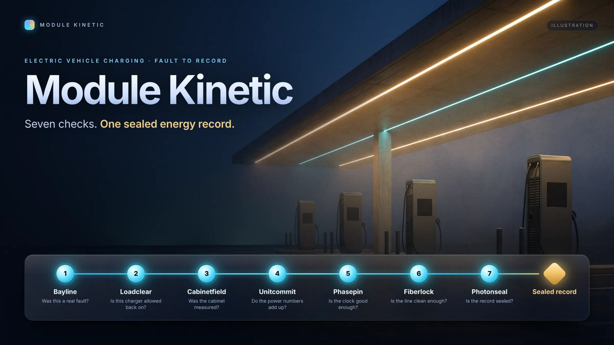
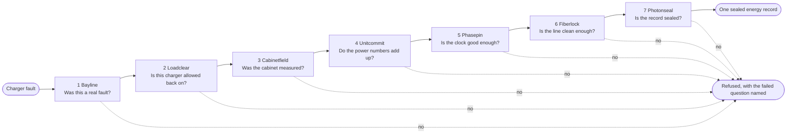

> **Business:** Module Kinetic (operating brand: Module Kinetic Ltd.)
> **Owner:** Digital Currensy Inc. (all rights reserved)
> **Document:** Public portfolio showcase. Documentation only, no source code
> **Status:** Published (documentation showcase)
> **Date:** 2026-10-19

# Module Kinetic

**Proof, not opinion, for every EV charger repair.**

When a commercial EV charger faults, someone eventually writes "cleared". Module Kinetic makes that word mean something. Each fault goes through seven checks in a fixed order. If every check says yes, you get one sealed energy record that anyone with the key can verify. If any check says no, nothing is saved, and the refusal names the question that failed. There's no partial record and no "probably fine". Module Kinetic never runs the chargers. It only decides what can be trusted.

> This repository describes what the products do and why. It contains no source code. The code is private and owned by Digital Currensy Inc.

## Why it matters

| Buyer | The problem today | What Module Kinetic gives them |
|---|---|---|
| **Charging operator** | Faults get lost in status noise, and chargers go back on before they're safe. | Every real fault becomes one repair job. A charger can't return to service until its lockout is lifted and it's inside safe limits. |
| **Utility** | Reported power doesn't match what the grid saw, and cabinet ratings are guesses. | Power is planned from measured cabinet limits, and a mismatch is refused, not reported. |
| **Auditor** | Timestamps rest on GPS alone, and records can be edited afterwards. | Every record carries a trusted time source, travelled over a checked link, and is sealed so any change shows. |

## The seven checks

Each check answers one question. A "yes" passes plain values to the next check. A "no" stops the chain and names the failed question.

## The products

| # | Product | The question | Details |
|---|---|---|---|
| 1 | Bayline | Was this a real fault? | [docs/bayline.md](docs/bayline.md) |
| 2 | Loadclear | Is this charger allowed back on? | [docs/loadclear.md](docs/loadclear.md) |
| 3 | Cabinetfield | Was the cabinet measured? | [docs/cabinetfield.md](docs/cabinetfield.md) |
| 4 | Unitcommit | Do the power numbers add up? | [docs/unitcommit.md](docs/unitcommit.md) |
| 5 | Phasepin | Is the clock good enough? | [docs/phasepin.md](docs/phasepin.md) |
| 6 | Fiberlock | Is the line clean enough? | [docs/fiberlock.md](docs/fiberlock.md) |
| 7 | Photonseal | Is the record sealed? | [docs/photonseal.md](docs/photonseal.md) |

To follow one fault through all seven checks, see [docs/end-to-end.md](docs/end-to-end.md).

## Shared principles

- **Refuse, don't guess.** A failed check saves nothing and names the failed question.
- **Once only.** Sending the same fault or result twice never creates a second record.
- **Never rewritten.** Saved records are only ever added to. Nothing is edited or deleted.
- **One customer per record.** Every record is tied to the customer it belongs to.
- **No secrets in the data.** Keys and passwords are never stored with the records.
- **Separate products.** Each check stands on its own and can be licensed on its own.
- **Tested end to end.** Every product has automated tests, and one test runs a sample fault through the full chain.

## Ownership and licensing

Module Kinetic, its seven products and this documentation are owned by **Digital Currensy Inc.** Module Kinetic Ltd. is the operating brand. This repository is documentation only and grants no licence to any code. See [LICENSE](LICENSE).

**Licensing enquiries:** Digital Currensy Inc.
