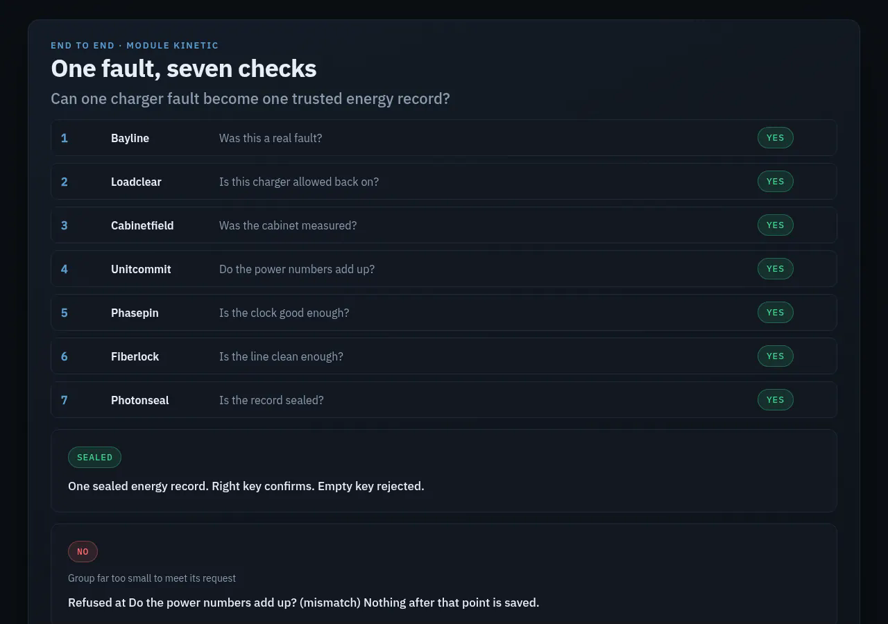

> **Business:** Module Kinetic (operating brand: Module Kinetic Ltd.)
> **Owner:** Digital Currensy Inc. (all rights reserved)
> **Document:** End-to-end story (all seven checks). Documentation only, no source code
> **Status:** Published (documentation showcase)
> **Date:** 2026-10-19

# One fault, seven checks

This story follows one sample fault from Module Kinetic's own end-to-end test. Every outcome comes from that test.

## The question

**Can one charger fault become one trusted energy record, or a clear refusal?**

## Who it's for

Anyone evaluating Module Kinetic as a whole: operators, utilities, auditors and buyers.

## The story

1. **Bayline: was this a real fault?** A charger's management system reports that a connector has faulted. Bayline confirms it's a real, open fault, locks the charger out and opens one repair job. **Yes.**
2. **Loadclear: is this charger allowed back on?** The charger is enrolled against that repair job. Once the fault is closed, it joins its site's group of chargers. **Yes.**
3. **Cabinetfield: was the cabinet measured?** The cabinet feeding the group shows a warning-level reading. Cabinetfield issues a power factor, and the group's allowed power shrinks. **Yes.**
4. **Unitcommit: do the power numbers add up?** With the reduced limit, Unitcommit plans the group's on/off schedule and checks the power balance. The plan meets the request within tolerance. **Yes.**
5. **Phasepin: is the clock good enough?** The site's atomic clock is healthy, and its announced error meets the utility timing standard. **Yes.**
6. **Fiberlock: is the line clean enough?** The fibre link is quiet, the key is long enough and the clock is trusted, so the path is approved. **Yes.**
7. **Photonseal: is the record sealed?** Every earlier check passed, so the energy record is sealed. The right key confirms the seal, and a wrong or empty key is rejected. **Yes.**

## Example outcome

| What happened | Outcome |
|---|---|
| The fault went through all seven checks | **Accepted.** One sealed energy record. |
| Results saved | One per check, seven in total |
| The same run sent again | Nothing new saved |
| No database connected | Nothing written |

## When it says no

The same test also runs a group far too small to meet its request, with no tolerance allowed. Unitcommit refuses at *Do the power numbers add up?* Nothing after that point is saved, and no record is sealed.

## What it isn't

- It doesn't control any charger, cabinet, switch or fibre link.
- The readings in this story were written for testing and don't come from real equipment.
