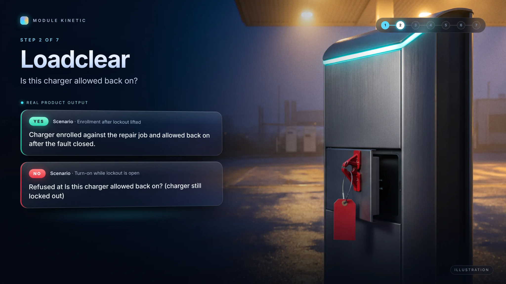

> **Business:** Module Kinetic (operating brand: Module Kinetic Ltd.)
> **Owner:** Digital Currensy Inc. (all rights reserved)
> **Document:** Product page: Loadclear (check 2 of 7). Documentation only, no source code
> **Status:** Published (documentation showcase)
> **Date:** 2026-10-19

# Loadclear

## The question

**Is this charger allowed back on?**

Loadclear decides whether a repaired charger can return to service and count toward the power a site can offer.

## Who it's for

- **Charging operators**, who must never switch on a charger that's still locked out or unsafe.
- **Utilities**, who need an honest figure for how much power a site can really provide.

## What it refuses

- A charger with no repair job from Bayline.
- Switching on a charger that's still locked out, or at a site with an open fault.
- A charger outside its safe limits: too hot, outside its charge range, over its export limit or past its battery wear budget.
- A request to run for longer than the car will stay plugged in.
- Readings from a charger that hasn't been enrolled.
- A fault message sent to the readings intake, which belongs in Bayline.
- Saving the same enrolment twice.

## How it decides

1. **Is there a repair job?** No repair job means no enrolment.
2. **Is the lockout lifted?** A charger stays unavailable until its fault is closed.
3. **Is it inside its safe limits?** Heat, charge level, export power, battery wear and time until departure are all checked.
4. **Group the chargers that pass.** Only chargers that pass add power to the site's group. A blocked charger adds nothing and is listed by name.

Loadclear hands that group of chargers on to the next checks.

## Example outcome

These outcomes come from Module Kinetic's own test cases.

| Input, in words | Outcome |
|---|---|
| Two chargers at one site. One fault is closed, the other is still open. | **Accepted.** The group counts power only from the closed charger. The other is listed as blocked. |
| A switch-on request while the lockout is still in place | **Refused** at *Is this charger allowed back on?* (lockout open) |
| The same charger after its fault is closed | **Accepted.** Cleared to switch on. |
| A charger with no repair job | **Refused** at *Is this charger allowed back on?* (no repair job) |
| Readings that arrive before the charger is enrolled | **Refused** at *Is this charger allowed back on?* (no repair job) |

## What it isn't

- It doesn't check the power numbers. That's Unitcommit's job.
- It doesn't seal the record. That's Photonseal's job.
