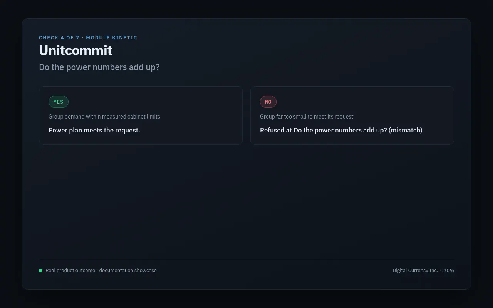

> **Business:** Module Kinetic (operating brand: Module Kinetic Ltd.)
> **Owner:** Digital Currensy Inc. (all rights reserved)
> **Document:** Product page: Unitcommit (check 4 of 7). Documentation only, no source code
> **Status:** Published (documentation showcase)
> **Date:** 2026-10-19

# Unitcommit

*Illustration: product art, not a photo of real equipment. Yes and no cards: real product output, same words as the run.*

## The question

**Do the power numbers add up?**

Unitcommit plans which groups of chargers are on in each time slot. It then checks separately that the power really balances. A plan alone is never accepted as proof.

## Who it's for

- **Operators' energy desks**, who commit power to the grid.
- **Utilities**, who need the power delivered to match the power requested.

## What it refuses

- A gap between power delivered and power requested that's larger than the allowed tolerance.
- A plan whose size doesn't match the problem it was built for.
- A plan too large to solve reliably.
- Saving any result that didn't pass.

## How it decides

1. **Apply the cabinet limit first.** Each group's power range shrinks by Cabinetfield's factor. A cabinet taken out of service forces its group off.
2. **Plan by group, not by charger.** For each group and time slot, the plan decides whether it's on and whether it's starting up. This is done with **optimisation**: picking the lowest-cost plan that meets the rules.
3. **Check the plan's size.** The plan and the balance check must cover exactly the same choices.
4. **Check the balance.** Power delivered is compared with power requested, including the limits of the power lines. A gap beyond the tolerance is refused.
5. **Save only a pass**, once.

## Example outcome

These outcomes come from Module Kinetic's own test cases.

| Input, in words | Outcome |
|---|---|
| A cabinet limit applied to a group before planning | **Accepted.** The group's power range shrinks first. |
| A cabinet taken out of service | **Accepted.** Its group is forced off. |
| A group far too small for the power requested | **Refused** at *Do the power numbers add up?* (mismatch) |
| A plan that meets demand within tolerance | **Accepted.** The run is cleared. |
| A power line too small to carry the plan | The balance check shows a gap. |
| A plan with the wrong number of choices | **Refused** at *Do the power numbers add up?* (wrong size) |

## What it isn't

- It doesn't run on a quantum computer.
- It doesn't seal the record. That's Photonseal's job.
